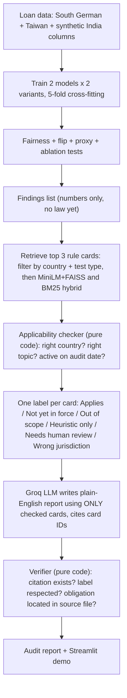

# ⚖️ RGCA — Regulatory-Grounded Compliance Auditor


> Audits AI loan-approval models for group bias, then explains every finding using
> **verified legal rule cards** from the US, EU and India — so a chatbot can never
> invent a law. **The LLM writes prose. Pure code decides what the law says.**

Built as a hackathon project (Python on Windows, Groq free API).

---

## Table of contents

1. [The problem, in two sentences](#the-problem-in-two-sentences)
2. [The one big idea: rule cards](#the-one-big-idea-rule-cards)
3. [How the whole thing works](#how-the-whole-thing-works)
4. [The six legal labels](#the-six-legal-labels)
5. [Datasets (and the traps we caught)](#datasets-and-the-traps-we-caught)
6. [What we audit: tests and thresholds](#what-we-audit-tests-and-thresholds)
7. [Legal coverage (US / EU / India)](#legal-coverage-us--eu--india)
8. [Headline results on real data](#headline-results-on-real-data)
9. [Anti-hallucination: how we measure it](#anti-hallucination-how-we-measure-it)
10. [Tech stack](#tech-stack)
11. [Repo layout](#repo-layout)
12. [Quick start (Windows)](#quick-start-windows)
13. [The 5-click faculty demo](#the-5-click-faculty-demo)
14. [Honest limitations](#honest-limitations)
15. [Open items (by design, not failures)](#open-items-by-design-not-failures)
16. [Team](#team)
17. [Data & legal attribution](#data--legal-attribution)
18. [License](#license)

---

## The problem, in two sentences

**Problem 1 — loan AI can be unfair.** A bank trains a credit model on old data, the
model learns old habits (e.g. women approved at 0.64× the men's rate), and nobody
notices because the model is a black box.

**Problem 2 — chatbots invent laws.** Ask a normal chatbot "is this illegal?" and it
guesses. Real example we caught: it says *"this violates the EU AI Act"* — but the EU
AI Act's credit-scoring rules only start on **2 December 2027**. On our audit date
(24 Nov 2026) that claim is simply wrong.

**Our fix:** never let the chatbot decide what the law says. We write the law into
small, hand-checked **rule cards** first. The LLM is only allowed to write sentences
using cards that passed three code checks.

---

## The one big idea: rule cards

Think of an old library. It has thousands of books but finds any one fast, because
every book has a small index card with fixed boxes: title, author, shelf number. You
search the cards, not the books.

We do the same for laws. Each legal rule gets one small JSON card with fixed boxes:

| Box | Meaning |
|---|---|
| `jurisdiction` | Which country / region (US / EU / IN) |
| `clause` | Exact place in the law (e.g. *AI Act, Annex III, 5(b)*) |
| `source_url` + `source_file` | Official link **and** the file we hold on disk |
| `status` | How strong: binding law / regulation / guidance / heuristic |
| `applies_to` | Topic: lending, employment, data-quality, … |
| `effective_from` | The date the rule starts (or `null` if unknown) |
| `obligation` | The rule in **one sentence** |
| `caveat` | Fine print we must not lose |
| `test_type` | Which of our audit tests it connects to |
| `threshold` | Numeric line, if any (e.g. 0.8) |
| `to_verify` | What we have **not** double-checked |
| `applicability_uncertain` | `true` → forces "Needs human review" |

Before any card may be used, **code** (not the LLM) asks three questions:
**right country? right topic? active on the audit date?** The answer becomes a label.

---

## How the whole thing works



In plain words, step by step:

1. **Load & decode** three real datasets using the *official* UCI code table (never
   from memory). The code raises an error on any unknown code, so a bad decode can't
   pass silently.
2. **Train** a logistic regression and a gradient-boosted tree, each in two versions:
   `uses_protected` (sees age/sex/etc.) and `unaware` (those columns removed). Every
   applicant is scored by a model that never saw them (**5-fold cross-fitting**), so
   tiny groups keep all their members.
3. **Run the audit tests** (fairness ratios, flip tests, proxy check, ablation) →
   a list of findings that are *just numbers*, no law yet.
4. **Retrieve** the 3 most relevant rule cards (hard filter by country + test type,
   then a hybrid meaning-search and keyword-search).
5. **Check applicability** with boring, testable code → one of six labels.
6. **Write the report** with Groq, using *only* the checked cards, citing card IDs.
7. **Verify** every citation against the real source files we hold on disk.
8. **Show it** in a demo-first Streamlit app.

> **Design rule:** the LLM writes prose, never decisions. All legal judgments (does
> this rule apply? since when?) are made by code.

---

## The six legal labels

| Label | Plain meaning |
|---|---|
| 🟢 **Applies** | Yes to all three checks. Use it. |
| 🟡 **Not yet in force** | Real law, starts later. Say "applies from 2027", never "you broke it". |
| ⚪ **Wrong jurisdiction** | Another country's law. Ignore. |
| ⚪ **Out of scope** | Another topic (e.g. hiring). Ignore. |
| 🔵 **Heuristic only** | A rule of thumb borrowed from another field. Mention, never call it a violation. |
| 🟠 **Needs human review** | We don't know enough (a `to_verify` box). A person must check. |

"Needs human review" is a **feature, not a failure**. The whole pitch is: the tool
says *"I'm not sure"* instead of inventing an answer.

---

## Datasets (and the traps we caught)

| File | Role | Size | Why |
|---|---|---|---|
| **SouthGermanCredit.asc** + `codetable.txt` (UCI 522) | **MAIN** | 1,000 rows (700 good / 300 bad) | UCI ships a *corrected* code table for it. Full pipeline runs here. |
| german.data + german.doc (Statlog, UCI 144) | Cross-check only | 1,000 rows | Has known coding errors (see below). |
| Taiwan "Default of Credit Card Clients" (UCI 353) | Statistical validation | 30,000 rows | The **only** clean `SEX` column; big enough for significance tests. |
| India columns (pincode, surname) | **Synthetic — we generate them** | added to German | No real Indian loan data with these fields; labelled `syn_` everywhere. |

**The traps (this is why we inspected before coding):**

- **Sex cannot be derived from German data.** The "personal status and sex" column
  mixes both. Code 2 = *"female non-single OR male single"* (ambiguous). So we never
  create a `sex` column for German; all sex tests use Taiwan.
- **Statlog's foreign-worker labels are REVERSED.** Statlog calls 963 people "yes";
  the corrected table shows 1 = yes (only **37** people). Confirmed on the real files.
  This is exactly why South German is the main dataset.
- **Taiwan is defaults, not approvals.** "Approved" in our pipeline means *"did not
  default"*. The report says this honestly.
- **South German `amount` is not real money** — a monotonic transform. We never call
  it DM or euros.
- **Small groups are fragile:** 37 foreign workers, 50 divorced males → minimum group
  size 30, and even then we flag fragility.

---

## What we audit: tests and thresholds

| Test | The question it answers | Threshold / verdict |
|---|---|---|
| **Selection-rate ratio** | Is a group approved less often than the best group? | 🚩 **FLAG** if ratio < 0.80 **and** significant; 🟡 **review** if 0.80–0.90 and significant; **insufficient data** if group < 30 |
| **Significance** | Could the gap be luck? | Fisher exact p-value (Benjamini–Hochberg FDR correction planned) |
| **Equal-opportunity gap** | Does the gap persist among people who actually repaid? | reported alongside the ratio |
| **Counterfactual flip** | Change *one* attribute for a rejected person — does the decision flip? | **Sanity check:** `unaware` models must show **0 flips** |
| **Proxy check** | Can we still *guess* the protected attribute from the remaining columns? | AUC ≥ **0.60** some signal, ≥ **0.70** strong; multi-group lift ≥ 0.07 / 0.15 |
| **Ablation** | Delete the leaking columns — does the gap actually shrink? | ratio drift toward 1.0 + AUC cost shown |
| **Scenarios** | Does the tool cry wolf? | **A (clean)** must stay quiet on synthetic cols; **B (planted)** must flag |

> The 0.8 line is a **screening heuristic** (it comes from US *employment* law), never
> a legal verdict by itself. The rule cards decide what each number means per country.

---

## Legal coverage (US / EU / India)

18 hand-written cards, each pointing to a file in `sources/`. The verified facts that
matter for the demo:

| Jurisdiction | Rule | What it really says | Consequence for us |
|---|---|---|---|
| US | Four-fifths rule (29 CFR 1607.4(D)) | 80% line is **employment** law, not a bright line | Lending use = **Heuristic only** |
| US | ECOA (15 U.S.C. 1691) | No credit discrimination on sex/marital/age/etc.; age *allowed* in sound scoring, never negative for elderly | Age finding = **review**, not violation |
| US | Reg B (12 CFR 1002.9) | Denial reasons must match the factors **actually scored** | Our SHAP-based explanation check |
| US | Reg B disparate-impact amendment | Effective **21 Jul 2026** | In force on our audit date (rare "new law, active now") |
| US | NYC Local Law 144 | Bias audits for **hiring** tools | Our deliberate **Out of scope** demo card |
| EU | AI Act Annex III 5(b) | Credit scoring = high-risk | Core EU card |
| EU | Digital Omnibus (Reg 2026/1744) | Annex III applies from **2 Dec 2027** | → **Not yet in force** today (flagship anti-hallucination demo) |
| EU | Articles 10 / 13 / 4a | Data-bias duty, transparency, special-category data for bias testing | From Dec 2027; 4a = **Needs human review** |
| IN | RBI FREE-AI (Aug 2025) | Sutras 4 & 6, Recs 24 & 18 | **Guidance**, never a violation |
| IN | Digital Lending Directions 2025, para 7 | Record-keeping only, **no bias clause** | Record-keeping card |
| IN | DPDP Act §8(3) + Rules 13(3) | Data-quality duty; SDF algorithm check | Main duties ~13 May 2027; no commencement notification held → **Needs human review** |

*(Full text of every card lives in `cards/`; each `obligation` is one sentence traceable
to a file in `sources/`.)*

---

## Headline results on real data

| Finding | Numbers | Meaning |
|---|---|---|
| German under-25 | 0.77–0.79 **FLAG** with age; 0.83–0.89 **review** without age | Robust gap; survives deleting age → **proxy** signal |
| German under-25 after ablation | ratio climbs to **0.91–0.93**, flag gone, **AUC cost ≈ 0** | housing + job tenure + dependents were *carrying* the gap |
| German foreign workers | 1.12–1.28 (favoured); flip no→yes rescues **34–72%** of rejections | A direct *bonus* the group ratio hid |
| Taiwan sex | group ratio 0.90–0.97 (no FLAG); flip male→female **18%**; proxy AUC 0.604 | Direct use, weak proxy; deleting the column fixes it |
| Taiwan marriage | **no group FLAG**, but flip married→single **28%** | The flip test caught what the group test missed |
| Taiwan under-25 | 0.885–0.892 even without age; proxy AUC **0.815** (LIMIT_BAL dominates) | Strong proxy path |
| Fairlearn cross-check | **15/15** matched | Our fairness math is correct |
| Scenario A (clean) | **no** synthetic FLAG | Tool stays quiet → doesn't cry wolf |
| Scenario B (planted) | pincode **0.47–0.56**, intersection **0.33–0.41** FLAG | Planted bias caught |
| Bundle flip (B) | **0.65** > single flips (0.48 / 0.35) | Intersectional bias worse than either part alone |
| Unaware sanity check | **0 flips** across every run | No protected column leaked |
| Rule cards | **18/18** validated against `sources/` | At 2026-11-24: 4 *Not yet in force*, 3 *Needs human review* |

---

## Anti-hallucination: how we measure it

This is the part that makes the project more than "a fairness dashboard".

1. **Applicability checker (pure code):** each retrieved card gets one of the six
   labels by answering *right country? right topic? active on the audit date?* — no LLM
   involved, so it is 100% testable.
2. **Verifier (pure code):** reads the finished Groq report and checks, per claim:
   - does every cited `[CARD-ID]` actually exist in `cards/`?
   - does the sentence **respect the label**? (e.g. the word "violate" near a
     *Heuristic-only* or *Not-yet-in-force* card = FAIL)
   - is the card's `obligation` **locatable in the source file we hold on disk**?
     HTML is read as text; PDFs are read with `pypdf` and detected by their `%PDF`
     bytes (one saved file had no extension). Words split across PDF lines are repaired
     before matching. A **match ratio** is reported per card (threshold 0.60).
3. The **pass rate** is a headline number for the demo/paper. On the demo findings it
   is **100%** (citation + label + evidence-in-source, including the RBI PDF at 0.90
   match).

> Honest framing for judges: we don't claim "100% legally verified". We claim *"the
> verifier locates each card's obligation keywords in the source file on disk and
> reports a match ratio; paraphrased obligations can score lower, and the fix is to
> quote rather than paraphrase."* Understanding your own measurement is stronger than
> a perfect number.

---

## Tech stack

| Layer | Tools |
|---|---|
| Data & models | pandas, scikit-learn (LogisticRegression, HistGradientBoosting) |
| Significance | scipy (Fisher exact), statsmodels (FDR, planned) |
| Fairness cross-check | fairlearn |
| Explanations | shap |
| Card search | sentence-transformers (`all-MiniLM-L6-v2`) + faiss-cpu, rank-bm25 (hybrid, reciprocal-rank fusion) |
| Report writing | **Groq** free tier (`llama-3.1-8b-instant`, temperature 0), key in `.env` |
| Verification | pypdf (PDF text extraction) |
| UI | Flask + HTML/CSS/JS + Chart.js + ReportLab (PDF/JSON export) |

---

## Repo layout

```text
rgca/
  data/        raw datasets + codetable.txt
  sources/     every legal file, named by card ID (HTML + PDF)
  cards/       one JSON file per rule card (18) + schema.json
  src/         all Python code
    01_inspect_data.py     load & sanity-check the 3 datasets
    data_loading.py        decode from the real code table; build target + age groups
    models.py              2 models x 2 variants, 5-fold cross-fitting
    fairness.py            ratios, Fisher p, verdicts, equal-opportunity gap
    03_fairness_tests.py   run fairness -> reports/fairness_results.csv
    counterfactuals.py     flip-test logic
    04a_counterfactual_tests.py
    proxy_check.py         probe predicts protected attr from non-protected cols
    04b_proxy_check.py
    04c_ablation.py        delete leaking cols, measure gap shrink + AUC cost
    scenarios.py           synthetic India cols + planted bias
    05_scenarios.py        Scenario A (clean) vs B (planted)
    card_schema.py         rule-card boxes + validator
    06_write_cards.py      write the 18 cards + validation report
    retrieval.py           hybrid card search (MiniLM+FAISS & BM25)
    applicability.py       pure-code 3-question checker -> 6 labels
    report_writer.py       Groq report writer (prose only, cites card IDs)
    verifier.py            citation + label + evidence-in-source check
  tests/       automated unit & integration tests (tests/test_rgca.py)
  reports/     generated CSVs + verification JSON
  app.py       Flask entry point (run: python app.py -> http://127.0.0.1:5000)
  web_app.py   Flask routes, APIs, and PDF/JSON report builder
  templates/   Jinja2 HTML pages
  static/      CSS & JS assets
  requirements.txt
  .env.example template for GROQ_API_KEY (copy to .env)
```

*Naming rule:* numbered files (`01_`, `03_`, …) are **run**, never imported (Python
can't import a name starting with a digit). Helper modules have no number.

---

## Quick start (Windows)

```powershell
cd E:\hackathon_thursday
python -m venv .venv
.venv\Scripts\activate
pip install -r requirements.txt

# 1) data sanity + decoding
python src\01_inspect_data.py
python src\data_loading.py

# 2) fairness, flips, proxy, ablation
python src\03_fairness_tests.py
python src\04a_counterfactual_tests.py
python src\04b_proxy_check.py
python src\04c_ablation.py

# 3) clean vs planted-bias scenarios
python src\05_scenarios.py

# 4) rule cards + validation against sources/
python src\06_write_cards.py

# 5) Groq key (optional, free tier) -> copy .env.example to .env and set GROQ_API_KEY=your_key
#    never paste the key into code

# 6) run automated tests
python -m unittest tests/test_rgca.py -v

# 7) launch the Flask web application
python app.py
# Open http://127.0.0.1:5000 in your browser
```

### Troubleshooting (Windows)
- **`ModuleNotFoundError`**: Ensure your virtual environment is activated and run `python -m pip install -r requirements.txt`.
- **Groq API disabled**: If `.env` is missing `GROQ_API_KEY`, all deterministic fairness, counterfactual, and legal applicability checks still work; only LLM prose generation is disabled.
- **Port 5000 in use**: Stop any existing Python/Flask process before running `python app.py`.

First run downloads the MiniLM embedding model (~90 MB, one time).

---

## The 5-click faculty demo

The UI is built so a non-technical viewer understands it in one minute:

1. **Live Demo tab** → pick a dataset + model. See 20 applicants with ✅ Approved /
   ❌ Rejected.
2. Pick a **rejected** person → pick one trait (e.g. *Age 22 → 35*) → click **Flip**.
   Watch the decision change: *"The model changed its mind just by seeing age."*
3. Scroll to **"Is that illegal?"** → traffic-light cards appear. With **EU** + audit
   date 2026, the credit-scoring card is 🟡 **Not yet in force** (*"applies from 2 Dec
   2027, so not a violation today"*).
4. Slide the **audit date to 2028** → the *same* card flips to 🟢 **Applies**. This
   proves the date-check is real code, not a hardcoded answer.
5. **Proof tab** → Scenario A ✅ quiet, Scenario B 🚨 flagged, bundle flip > single.

No CSV, no p-value on screen — just ✅❌, a flip button, and a legal traffic light.

---

## Honest limitations

1. Taiwan data is credit-card **defaults**, not loan approvals.
2. South German `amount` is a transformed value, **not real money**.
3. German data has **no usable sex column**; sex results come from Taiwan only.
4. India columns are **synthetic**; no claim about real Indian lenders.
5. Small groups (37 foreign workers, 50 divorced males) → fragile findings; min size
   30 and significance always shown.
6. Selection-rate gaps can reflect real repayment differences — that's why the
   equal-opportunity gap and flips are also reported.
7. The 0.8 line is a screening heuristic, never a legal verdict by itself.
8. US **state laws** are out of scope.
9. A high proxy AUC means information is *partly* visible, **not** perfectly
   reconstructable (we show AUC *and* balanced accuracy together).

---

## Open items (by design, not failures)

| Item | Handling |
|---|---|
| DPDP Act commencement notification not found | card keeps `to_verify` → **Needs human review**. A live demo of the design. |
| Whether any FREE-AI part became binding | kept as **guidance** (safe direction: never "violation"). |
| Multiple-comparison correction | it's code, not research: `statsmodels` FDR (`fdr_bh`), added in evaluation. |
| Exact effective dates of very old rules (ECOA 1974, Reg B) | long in force; enactment date + `to_verify` is fine. |

---


## Data & legal attribution

- **Datasets:** UCI Machine Learning Repository — Statlog German Credit (ID 144),
  South German Credit (ID 522, with corrected code table), Default of Credit Card
  Clients (ID 353). Used for research/demo only.
- **Legal sources** (saved locally in `sources/`, retrieved 2026-11-24): EUR-Lex
  (Reg. EU 2024/1689, Reg. EU 2026/1744), US Code / eCFR via LII, CFPB, Federal
  Register, NYC, RBI, MeitY. One wrong file (a Committee of the Regions *opinion* on
  the draft AI Act) was caught and rejected — no card uses it.
- **LLM:** Groq free tier. The model writes prose only; all legal applicability is
  decided by code.

---

## License

MIT — see `LICENSE`. *(Swap for Apache-2.0 / your institution's required license if
needed.)*